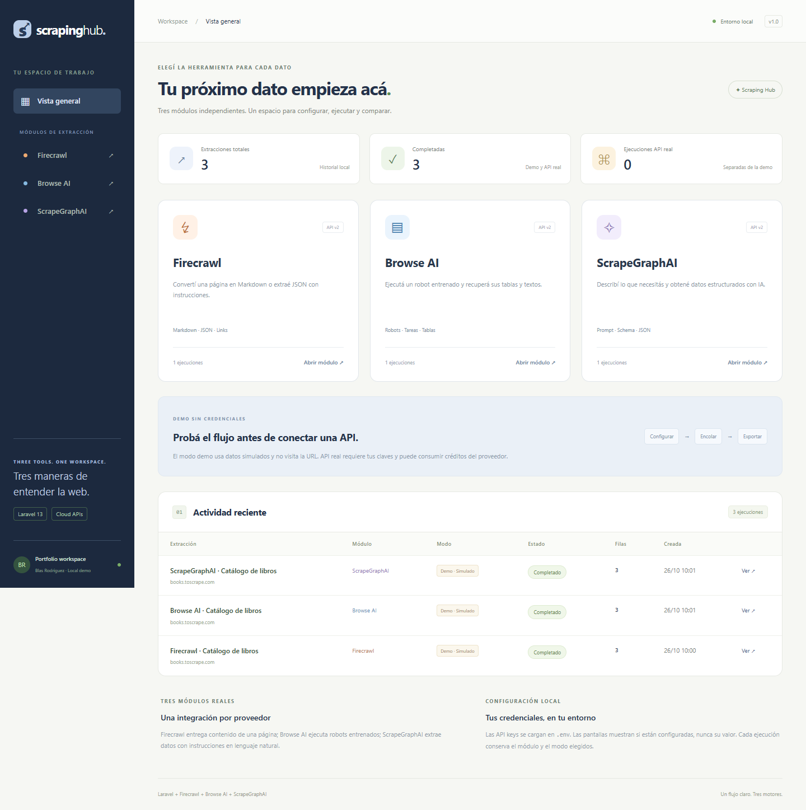
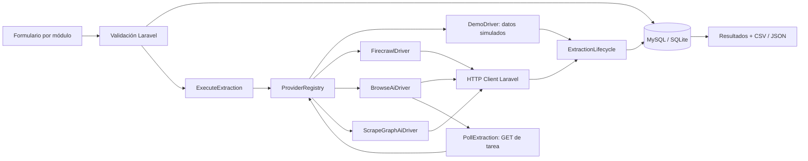
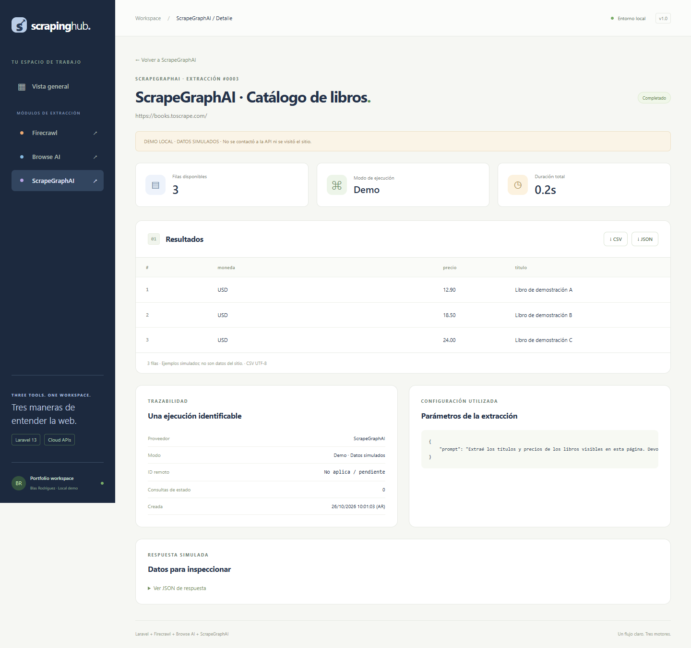

# Scraping Hub · Laravel

Tres módulos independientes para integrar **Firecrawl**, **Browse AI** y **ScrapeGraphAI Cloud** desde Laravel 13. Cada módulo tiene su formulario, adaptador, historial, estados y exportaciones. El backend utiliza las APIs REST oficiales mediante el HTTP Client de Laravel.

Proyecto de portfolio de **Blas Rodríguez**. Aplicación independiente de las demos de Playwright y Puppeteer.



## Modos de ejecución

- **Demo local:** resultados simulados, identificados en la pantalla, el historial y las exportaciones. No visita la URL ni contacta a los proveedores. Permite mostrar todo el flujo sin credenciales.
- **API real:** usa las claves de tu `.env`. Puede consumir créditos. Nunca cae al modo demo cuando falla una API.

**Las integraciones reales necesitan tus propias cuentas y credenciales.** Las pruebas de contrato usan respuestas controladas con `Http::fake`; eso no equivale a validar una cuenta real ni la extracción en un sitio concreto.

## Los tres módulos

| Módulo | Función implementada | API | Configuración |
| --- | --- | --- | --- |
| Firecrawl | Una página a Markdown + enlaces, o JSON guiado por prompt y schema opcional | `POST https://api.firecrawl.dev/v2/scrape` | `FIRECRAWL_API_KEY` |
| Browse AI | Ejecutar un robot existente y consultar su tarea hasta obtener tablas/textos | `POST /v2/robots/{robotId}/tasks` y `GET /v2/robots/{robotId}/tasks/{taskId}` | API key, robot entrenado y nombre del parámetro URL |
| ScrapeGraphAI | Extraer JSON desde una URL con instrucciones y schema opcional | `POST https://v2-api.scrapegraphai.com/api/extract` | `SCRAPEGRAPH_API_KEY` |

Firecrawl y ScrapeGraphAI se ejecutan de forma síncrona dentro de un job. Browse AI crea una tarea remota y se consulta mediante jobs separados, sin reenviar el robot. El módulo de ScrapeGraphAI usa **la API cloud v2**, no la librería Python local ni el endpoint v1 `smartscraper`.

Referencias oficiales: [Firecrawl Scrape](https://docs.firecrawl.dev/api-reference/endpoint/scrape), [Browse AI API](https://developers.browse.ai/), [Browse AI: primera tarea](https://help.browse.ai/en/articles/12683249-api-guide-getting-started), [ScrapeGraphAI Extract v2](https://docs.scrapegraphai.com/api-reference/endpoint/extract).

## Instalación

Requisitos: **PHP 8.5**, Composer 2 y MySQL o SQLite con la extensión PDO correspondiente. Node.js **22.12+** y npm permiten iniciar los dos procesos juntos y ejecutar las pruebas de navegador; no ejecutan el scraping cloud.

Desde el directorio del proyecto, en PowerShell:

```powershell
Copy-Item .env.example .env
composer install
php artisan key:generate
npm ci
php artisan scraper:database
npm run dev
```

Abrí **http://127.0.0.1:8002**. El comando de desarrollo inicia Laravel y el worker. Los tres proyectos pueden convivir en los puertos 8000, 8001 y 8002.

En Linux/macOS reemplazá `Copy-Item` por `cp`. La configuración compartida usa SQLite para facilitar que alguien clone y pruebe la demo.

También podés iniciar manualmente, en dos terminales:

```powershell
php artisan serve --host=127.0.0.1 --port=8002
```

```powershell
php artisan queue:work --tries=1 --timeout=150 --sleep=1
```

No requiere compilación de frontend ni navegador para el scraping. La interfaz usa Blade, CSS y JavaScript locales. Puppeteer es únicamente una dependencia de desarrollo para probar la interfaz.

### MySQL de WampServer

Iniciá MySQL y configurá tu `.env` local:

```dotenv
APP_NAME="Scraping Hub"
APP_URL=http://127.0.0.1:8002
DB_CONNECTION=mysql
DB_HOST=127.0.0.1
DB_PORT=3306
DB_DATABASE=scraping_hub
DB_USERNAME=root
DB_PASSWORD=
```

Usá las credenciales de tu instalación; `root` sin contraseña solo corresponde a algunas configuraciones locales de Wamp.

```powershell
php artisan config:clear
php artisan scraper:database
```

El comando crea la base si no existe y aplica migraciones sin borrar datos. Se utiliza InnoDB. Si no tenés permiso para crear bases, creá `scraping_hub` en phpMyAdmin y ejecutá `php artisan migrate`.

Para servir con Apache, apuntá el virtual host a `public/` y habilitá `mod_rewrite`. La cola requiere su propio worker.

## Conectar las APIs reales

Cargá las claves solamente en `.env`, excluido de Git:

```dotenv
FIRECRAWL_API_KEY=
BROWSE_AI_API_KEY=
BROWSE_AI_ROBOT_ID=
BROWSE_AI_URL_PARAMETER=originUrl
SCRAPEGRAPH_API_KEY=
```

Luego ejecutá `php artisan config:clear` y reiniciá el worker. Si usás `npm run dev`, detenelo y volvé a iniciarlo. Las pantallas muestran si cada clave está configurada, sin revelar su valor.

### Firecrawl

Elegí **API real** y una URL pública. Markdown devuelve el contenido principal y conserva los enlaces en la respuesta del proveedor. JSON permite agregar instrucciones y un JSON Schema opcional.

El request usa autenticación Bearer y envía únicamente las opciones del módulo, sin acciones personalizadas, crawling masivo ni headers de destino.

### Browse AI

Creá o entrená un robot en tu cuenta de Browse AI. En **Integrate → Rest API**, copiá el Robot ID y el nombre exacto del parámetro que recibe la URL. No todos los robots usan `originUrl`.

El formulario permite sobrescribir el Robot ID configurado y agregar otros parámetros como objeto JSON. El parámetro URL se completa con la URL de origen del formulario, incluso si el objeto adicional incluía otro valor.

No entrenamos robots mediante la aplicación. El módulo ejecuta robots existentes; sus campos, interacciones y alcance dependen del entrenamiento realizado en Browse AI.

### ScrapeGraphAI

Elegí **API real**, completá la URL y describí los datos deseados. Se envían `url`, `prompt` y, si está definido, `schema` al endpoint v2 `/extract`, con el header `SGAI-APIKEY`. Se normaliza el campo `json` y se conservan el ID, uso de tokens y demás metadatos en la respuesta inspeccionable.

Ejemplo de schema opcional para los módulos de extracción JSON:

```json
{
  "type": "object",
  "properties": {
    "products": {
      "type": "array",
      "items": {
        "type": "object",
        "properties": {
          "title": { "type": "string" },
          "price": { "type": "string" }
        }
      }
    }
  }
}
```

La aplicación valida el JSON y su estructura raíz; cada proveedor valida el schema completo. Una extracción con IA puede omitir o interpretar mal información: verificá los resultados contra el destino.

## Arquitectura



Los adaptadores están en `app/Services/Scraping/`. Comparten el contrato `ScrapingDriver` y devuelven `ProviderResult`. Los controladores y jobs no necesitan conocer la forma particular de cada respuesta.

- `ApiTransport` autentica, fija timeouts, deshabilita redirecciones y limita respuestas a 2 MB. Los endpoints están definidos en código; el usuario no puede cambiar el host al que se envían las claves.
- `ExecuteExtraction` reclama un registro en cola mediante una actualización condicional. Una entrega duplicada no reenvía la extracción.
- `PollExtraction` consulta tareas de Browse AI con nuevos jobs demorados, sin mantener un worker esperando en un bucle. Reintenta errores transitorios **GET**, con límite; nunca reintenta automáticamente el **POST** de creación.
- El límite de espera es de 30 consultas remotas o 15 minutos. Un timeout local no cancela una tarea remota.
- Los requests HTTP tienen timeout de 120 s; los jobs, de 150 s; `retry_after` es 240 s. Una respuesta de red ambigua puede significar que el proveedor aceptó el trabajo: revisá su dashboard antes de reenviar.
- `ResultData` normaliza objetos o listas. Prioriza listas `items`, `products`, `results` y `records`; Browse AI también admite listas con nombres propios. La respuesta original sanitizada queda disponible para inspección.
- `SensitiveData` oculta claves conocidas y campos de credenciales en respuestas y errores. No es un detector completo de datos sensibles arbitrarios.
- El modo queda persistido por ejecución y viaja en las exportaciones. Los CSV de demo se identifican como `DEMO_DATOS_SIMULADOS` y sus filas incluyen `_mode` y `_provider`.



## Resultados y límites

El historial general reúne todos los módulos; cada módulo filtra sus propias ejecuciones. Las rutas verifican que una ejecución pertenezca al módulo solicitado.

Los datos se guardan como JSON en la tabla `extractions`, con máximo local de 500 filas y 2 MB de resultados normalizados. Las tablas muestran texto escapado; no ejecutan HTML ni Markdown del proveedor. Los CSV incluyen BOM UTF-8 y neutralizan fórmulas de celdas; el JSON conserva el valor del dato y la indicación de demo/API real.

La aplicación no vuelve a descargar screenshots ni archivos indicados por un proveedor. Las evidencias disponibles son la respuesta JSON y los metadatos que devuelva cada API.

Las URLs deben ser HTTP(S), sin credenciales, en puertos 80/443. Se rechazan hosts locales conocidos y literales de IP privadas/reservadas. La aplicación no resuelve ni descarga el destino: quien navega es la infraestructura del proveedor. Esta validación no certifica la política de red, las redirecciones o las interacciones del robot remoto.

## Pruebas

```powershell
php artisan test --compact
npm run browsers
npm run test:e2e
```

El Chrome descargado solo se necesita para E2E. `.npmrc` deshabilita scripts automáticos de instalación, por eso la descarga se solicita explícitamente.

Las pruebas PHP cubren:

- Contratos de Firecrawl v2, Browse AI v2 y ScrapeGraphAI v2, incluyendo headers y payloads.
- Respuestas JSON y Markdown, listas de robots, errores HTTP y datos malformados.
- Credenciales ausentes, datos privados, redacción de secretos y aislamiento entre módulos.
- Jobs duplicados, creación única de tarea, polling, errores transitorios y límite de espera.
- Escape HTML, prevención de fórmulas CSV y etiquetado de datos simulados.

`Http::preventStrayRequests()` impide llamadas no simuladas en las pruebas PHP. Las pruebas E2E usan exclusivamente modo demo y fuerzan claves vacías: recorren los tres módulos, sus exportaciones y el diseño móvil con historial cargado. Inician Laravel/worker en el puerto **8012** y usan una base SQLite separada en `storage/framework/testing/e2e.sqlite`.

GitHub Actions ejecuta PHP y E2E, y conserva screenshots de fallos en `test-results/`. El workflow está preparado; su ejecución en GitHub requiere publicar el nuevo repositorio.

## Presentación en una entrevista

1. Mostrá los tres módulos y explicá por qué sus formularios y respuestas son distintos.
2. Ejecutá una demo por proveedor y señalá que los datos son simulados.
3. En Browse AI, mostrá la transición a espera y el ID de tarea: consultar no equivale a volver a ejecutar el robot.
4. Mostrá el contrato común y cada adaptador, junto con sus pruebas HTTP.
5. Compará CSV/JSON y el tratamiento de errores y solicitudes duplicadas.
6. Si configurás claves, probá un sitio permitido y contrastá los resultados con la fuente. Separá esa validación real de las pruebas simuladas.

## Alcance y publicación

Demo local sin autenticación. Antes de alojarla, agregá autenticación/autorización por usuario, cuotas, control de concurrencia y almacenamiento cifrado de credenciales por cuenta si necesitás múltiples usuarios. No expongas esta instalación directamente a internet.

No se crean cuentas, robots ni suscripciones automáticamente. Las tarifas, créditos y permisos dependen de cada proveedor. Respetá las condiciones del sitio y del servicio; no se interpreta `robots.txt` desde Laravel.

No pegues contraseñas ni claves en prompts o parámetros de robot: esos campos forman parte de la receta persistida. No subas `.env`, bases de datos ni respuestas privadas al repositorio público. Las bases, logs, archivos de prueba y dependencias están excluidos de Git.

El proyecto tiene un Git local independiente, sin remoto preconfigurado. Asociá el nuevo repositorio antes de hacer push.

## Licencia

MIT. Ver `LICENSE`.
